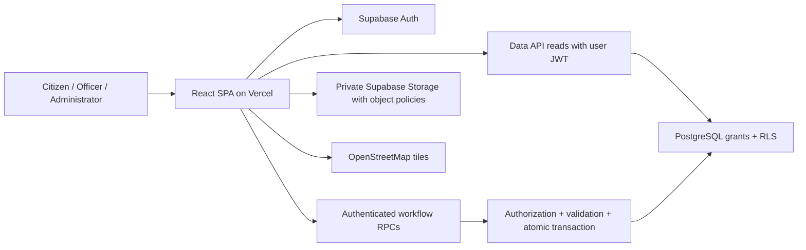

# Proposed architecture

## Decision and trust boundaries

Use one React/TypeScript single-page application built by Vite, styled with Tailwind, hosted on Vercel, with Supabase Auth, PostgreSQL and private Storage as the backend. Supabase's Data API handles scoped reads; narrow PostgreSQL RPC functions own business mutations. This meets the stack and keeps deployment understandable for a five-member student team.



React route guards provide navigation and loading behavior. Database policies and functions make authorization decisions. A user can bypass the UI, so browser checks never grant authority. No custom Express server, ORM, event bus, microservices, or separate REST API is needed initially. Add a Supabase Edge Function only for a later approved operation that genuinely requires a server-held external credential or Auth Admin API.

## Layers and ownership

```text
src/
  app/                        router, providers, layouts, role navigation
  features/
    auth/                     signup, login/logout, session and role loading
    profiles/                 citizen profile and permitted self edits
    complaints/               submission, detail, citizen list/tracking
    categories/               category selection and admin maintenance
    evidence/                 upload reservation, upload, finalize, download
    assignment/               officer/department assignment and priority
    workflow/                 review, start, progress, resolve, timeline
    officer-workspace/        queue pages composing officer features
    notifications/            in-system updates and read state
    feedback/                 post-resolution rating/comment
    admin/                    existing-user access management, monitoring
    officer/                  queue, assignment/priority, processing and resolution
  shared/
    ui/                       reusable buttons, inputs, dialogs, states
    location/                 lazy map picker and coordinate validation
    lib/supabase/             single browser client and generated DB types
    config/                   validated public environment configuration
    errors/                   safe error normalization
supabase/
  migrations/                 ordered version-controlled SQL changes
  tests/                      real database/RLS/transaction tests
  seed.sql                    synthetic local development data only
tests/e2e/                    Playwright journeys and API bypass cases
docs/                         requirements, design and review evidence
```

This is the target tree. Sprint 1 implements auth, profiles, admin access management and shared foundation; later feature directories are created only as their working increments arrive. Avoid empty files or abstract repository frameworks in advance of working features.

Sprint 2 implements `complaints/`, `evidence/` and shared location controls. Complaint category/department reads currently live in the complaint data adapter and its models; a separate category-admin module will own future maintenance RPC/UI. Complaint pages compose only the public evidence interface. Shared resource hooks ignore late responses after a newer read/unmount; protected content unmounts on logout/account change. Background access checks on tab return preserve an active draft while still failing closed on a missing/inactive profile or failed profile read. No global query-state dependency is introduced.

Sprint 4 adds `feedback/`, `notifications/` (with a lightweight `badge` entry used by the app shell) and `categories/`, and an Administrator monitoring overview in `admin/`.

The Officer increment implements assignment/workflow/queue in one layered `officer/` feature, preserving the original team ownership in the roadmap. Separate `assignment/`, `workflow/` and `officer-workspace/` directories remain target boundaries if those modules grow; they are not duplicated now. `officer/` composes the complaint feature's public detail/card/model interfaces through a render slot. Complaint code never imports Officer internals. Every intent has a narrow data adapter and its own SQL function.

Each feature uses only the layers it needs:

- `ui/`: React components and pages; render props/state, collect input, show loading/errors. No `.from()` or `.rpc()` calls.
- `model/`: TypeScript domain types, pure business rules, and validation schemas, independent of React and Supabase.
- `application/`: use cases and hooks coordinating validation, mutation and refresh. No SQL strings or privileged authorization decisions.
- `data/`: explicit Supabase selects and RPC adapters; map generated database types to feature types.
- `index.ts`: small public feature interface. Cross-feature imports use this interface, never reach into another feature's data implementation.

Direction: UI -> application -> model/data -> shared Supabase client. The model depends on neither UI nor data. Workspaces compose feature interfaces and do not duplicate mutation logic. SQL is authoritative for security-sensitive rules; frontend rules provide immediate feedback and must be tested for agreement.

Use React Router for navigation and a small schema validator such as Zod if approved during scaffold setup. Begin with feature hooks and local state; add a query-cache library only if actual cache/refetch complexity warrants it. No global Redux store is necessary for the baseline.

## Main flows

### Authentication and user management

Supabase Auth stores identities and passwords; application profiles store role, active state and department. A database signup trigger ignores role/active/department from user metadata and creates a Citizen profile. Use verified email and Supabase password recovery. Missing profiles fail closed and show a recoverable setup error.

The SPA subscribes to auth changes, loads the current profile and clears role-specific cached data on logout or account change. Privilege changes and deactivation take effect at the database using current profile state even when the JWT has not expired. Admins operate on existing app profiles through an audited RPC; they do not receive an Auth Admin key.

The user now explicitly requires Administrator-created Officers. One Supabase Edge Function, `provision-officer`, is justified for the Auth Admin invitation API. It validates the caller with `auth.getUser`, reads the live active Administrator profile, validates an active department and sends an invitation using a runtime-only privileged client. It then uses the caller JWT for the existing audited `admin_update_user` RPC. Client-supplied roles, redirects and Auth metadata never authorize access. Auth creation and profile promotion are separate transactions: a failed promotion is reported as pending and leaves no Officer privileges. Administrators resolve it through User management; there is no destructive account rollback or automatic email retry. `/accept-invite` lets the recipient set their own password without changing their role. See [Officer implementation and operational review](officer-portal.md).

Initial session design: configure `supabase-js` for in-memory sessions (`persistSession: false`); let the SDK handle refresh while the app is open. A full browser reload requires login again. This intentionally avoids persisting bearer/refresh tokens in localStorage for the prototype. If persistent sessions become necessary, review the UX/security tradeoff before adopting SDK storage or a cookie-backed server architecture. Memory-only storage reduces persistence exposure but cannot defeat active XSS.

### Submission, location, and evidence

Validate category, description, location text and coordinates; `submit_complaint` derives citizen identity and initial status/department on the database. Display the returned UUID only after commit. Use a per-submission UUID request key so network retries return the same complaint instead of creating duplicates.

Lazy-load React Leaflet. Support click/drag marker, readable coordinates, labelled numeric coordinate inputs, and location description. The user's 2026-10-21 refinement of CF-04 adds an explicit Use my current location button and a closer initial Southern Province view. The default view does not select a complaint location or restrict reports to that province. A shared location-selection hook coordinates the form fields, one-shot browser geolocation adapter and map focus; a successful fix sets the editable pin/coordinates and zooms to the location. No geolocation request runs before the button is activated, and no continuous tracking is started. Manual edits, cancellation and unmount invalidate pending results. Permission denial, unavailable devices or timeout leave manual selection usable. Accuracy is shown as an estimate, not saved as extra personal data. See the [browser geolocation contract](https://developer.mozilla.org/en-US/docs/Web/API/Geolocation/getCurrentPosition). No geocoding API or address search is required. Map failure must leave coordinate input usable. Persist coordinates/text, never tile images. Respect OpenStreetMap attribution, cache behavior and tile usage limits; no bulk prefetch/offline tile download. Third-party tile requests reveal approximate viewed areas and IP addresses, so do not put complaint text or citizen identifiers in requests. See the [OSM tile policy](https://operations.osmfoundation.org/policies/tiles/).

Evidence is optional: first create the complaint, then reserve an evidence record, upload privately, and finalize the attachment. A failed upload does not erase the submitted complaint; show retry state. File and database writes are not one atomic transaction; design cleanup of expired reservations explicitly. See the [evidence contract](database-design.md#evidence-storage).

### Officer lifecycle and citizen updates

The officer queue is department-scoped and paginated. Assignment and priority use separate operations; review/start/resolve use an explicit transition function. Every mutation checks the live actor, locks relevant records, validates the expected complaint version, writes history and notification in the same transaction, and returns the new version. A stale client refetches instead of silently overwriting another officer's work.

The citizen sees current state, progress timeline, resolution details/date and in-system notifications. Refetch after writes, navigation and window focus, with a manual refresh action. Realtime subscriptions, external email/SMS and push are unnecessary for the approved update behavior. Unread notifications are durable in PostgreSQL.

CF-22 adds an owner-only withdrawal intent in the complaint feature, using a dedicated application hook/data RPC and reason/confirmation UI. The backend permits only unresolved source states, checks live ownership/role and the expected version, then atomically records final Withdrawn and its reason/history/update. Attached evidence and prior events remain available. Withdrawn is a final branch, not a fifth step after Resolved; uploads and future officer mutations must reject it. This is the user's explicit scope extension, detailed in [citizen withdrawal](citizen-withdrawal.md).

Feedback becomes available only on the owner's resolved complaint. Admin category/user changes use dedicated use cases and audit records. Enhanced analytics remain a Could Have; required role workspaces are simple lists and counts.

## Deployment and configuration

Vercel builds the static Vite app and serves SPA deep links through a planned rewrite. Use separate local/test and hosted demonstration environments; preview deployments must not silently connect to production data. Supabase Auth redirect allowlists must contain only approved local/demo domains. Configure headers at the deployment layer: CSP tested against Supabase and map needs, `nosniff`, frame restrictions and a deliberate referrer policy. Do not weaken script policy merely to support inline Leaflet positioning styles; test their separate style requirements.

Only the project URL and publishable API key belong in frontend env variables. The publishable key identifies the app and is designed for public use; RLS and authenticated grants protect data. A secret/service-role key bypasses important controls and must never enter the frontend, source, logs or Vercel's public build environment. [Supabase key guidance](https://supabase.com/docs/guides/getting-started/api-keys) and [Vite environment guidance](https://vite.dev/guide/env-and-mode).

Version-controlled SQL is the source of truth for tables, enums, constraints, functions, policies, indexes and bucket configuration. Apply locally first and test from a fresh database. No click-only schema edits or automatic production migrations on pull requests. Review target, SQL, data impact, backup/recovery and approval before each remote migration. See the [roadmap](implementation-roadmap.md) for the planned migration sequence.

## Security risks and verification

These are design risks, not findings against an existing application.

| Risk | Control | Required evidence before release |
| --- | --- | --- |
| Role escalation through signup/profile edits | Fixed Citizen signup; privileged fields only through audited admin function; never trust user metadata | Crafted metadata/direct update tests; self-promotion denied |
| Reading another citizen's records or another department's queue | Grants plus RLS on tables and Storage, scoped child records | Direct Data API and Storage allow/deny tests using real user JWTs |
| Workflow bypass or concurrent lost update | Revoke direct table mutations; hardened RPCs, row locks and expected versions | Invalid transition, stale version, wrong-assignee, and rollback tests |
| Unsafe security-definer functions | Fixed empty search path, fully qualified names, explicit live authorization, narrow execute grants | Unauthenticated/unauthorized RPC calls and helper-recursion tests |
| Inactive user with valid existing token | Check active profile for every protected operation | Old JWT denied immediately after deactivation |
| Stored XSS/token theft | Plain text JSX, no untrusted HTML/map popup strings, in-memory auth, constrained scripts | Malicious complaint/remark/filename tests; deployed header inspection |
| Evidence leakage, active content, storage abuse | Private bucket, related-complaint authorization, restrictive types/size/count, no overwrite, attachment download | Foreign path, oversized/unsupported, spoofed metadata, and signed/download access tests |
| Secret leakage | Public env allowlist, ignored local env, no browser admin key | Scan tracked source/build output and inspect deployment configuration |
| Leaky views/reports | RLS-aware invoker reads; separately audited aggregate RPC if needed | Cross-role report tests before any monitoring release |
| Signup/spam and sensitive location data | Auth limits, verification, bounded inputs/uploads, private records, synthetic demos | Limit enforcement and privacy review; no production-readiness claim from a prototype |

Uploads are untrusted even with extension/MIME checks. A real public deployment needs a reviewed server-side inspection/quarantine strategy before broad document preview or claims of malware safety. For the prototype, restrict allowed formats, download PDFs as attachments, avoid embedded document rendering, and use synthetic evidence.

Primary technical references checked for this design: [Supabase RLS](https://supabase.com/docs/guides/database/postgres/row-level-security), [database function security](https://supabase.com/docs/guides/database/functions), [Storage access control](https://supabase.com/docs/guides/storage/security/access-control), [Auth sessions](https://supabase.com/docs/guides/auth/sessions), and [Vite on Vercel](https://vercel.com/docs/frameworks/frontend/vite).
