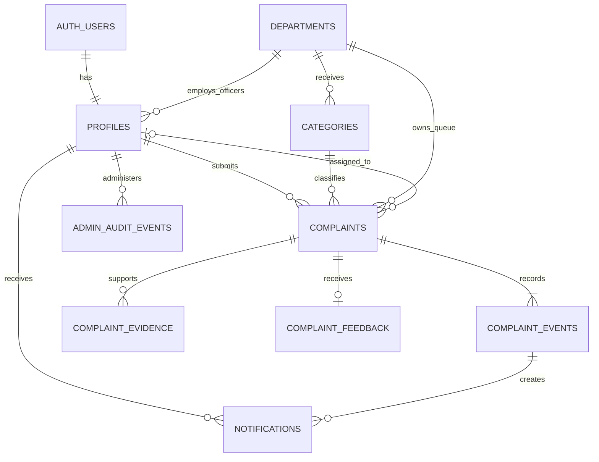

# Initial database and access-control design

Status: migrations 001-008, including citizen complaint/evidence operations, six routing categories and user-approved CF-22 withdrawal, are applied to the configured hosted project with user authorization. Later Officer/feedback/notification contracts below remain planned. The proposal requires Submitted and Resolved states and valid transitions; intermediate states and detailed policy below are documented design decisions/assumptions, not additional proposal requirements. Withdrawal is a separate explicit user request.

## Conventions

- PostgreSQL UUID primary keys generated by the database; `timestamptz` timestamps in UTC, displayed in the user's timezone. UUIDs reduce guessability but never replace authorization.
- `auth.users` is Supabase-managed. Never create a password column or duplicate Auth credentials. Application tables use a `public` schema with RLS; helpers and administrative audit details use an unexposed `private` schema.
- Enums: `app_role = citizen | officer | administrator`; `complaint_status = submitted | under_review | in_progress | resolved | withdrawn`; `complaint_priority = low | normal | high | urgent`. Withdrawn is the user-approved CF-22 extension. Priority values are proposed, not an emergency-service guarantee.
- Text is plain text. Trim input, reject empty required strings, and enforce bounds in SQL and client schemas. Avoid arbitrary user-supplied JSON as a mutation API.
- No application hard-delete operations for complaints, history, feedback or referenced lookup records. Deactivate lookup/users through controlled functions. Auth-user deletion and retention/pseudonymization need a separately reviewed policy.

## Tables

### `public.profiles`

| Column | Type / rule |
| --- | --- |
| `id` | UUID PK, FK to `auth.users(id)` with deletion restricted to preserve attribution |
| `display_name` | text, 1-100 trimmed characters |
| `role` | `app_role`, not null, default Citizen |
| `is_active` | boolean, not null, default true |
| `department_id` | nullable UUID FK to departments |
| `created_at`, `updated_at` | timestamps, server-generated |

Check: an officer must have a department; citizens and administrators have none in this initial single-department model. Role and active state are authoritative database data. Do not authorize using user-editable Auth metadata or cached client roles. No email/address/phone is duplicated unless a later approved requirement needs it. Admin UI can identify existing users by UUID and display name without exposing Auth tables.

### `public.departments`

`id uuid PK`, `name text UNIQUE NOT NULL` (1-100), `is_active boolean NOT NULL DEFAULT true`, `created_at`, `updated_at`. Departments are system reference data. Initial synthetic departments are migration/seed data; a complete department administration interface is not a new must-have. Expansion is data-driven through reviewed setup changes.

### `public.categories`

`id uuid PK`, `name text UNIQUE NOT NULL` (1-100), `description text` (up to 500), `department_id uuid NOT NULL FK departments`, `is_active boolean NOT NULL DEFAULT true`, `created_at`, `updated_at`.

Active categories must route to an active department. Names/descriptions/active state can change through admin RPCs. Once referenced, a category's department is immutable; create a replacement category and deactivate the old one to change routing. This prevents reference changes from silently moving historic complaints. Existing complaint displays can still read their inactive category.

### `public.complaints`

| Column | Type / rule |
| --- | --- |
| `id` | UUID PK generated server-side; visible complaint reference |
| `citizen_id` | UUID NOT NULL FK profiles; derived from `auth.uid()` |
| `submission_request_id` | UUID NOT NULL; unique with citizen ID for safe submit retries |
| `submission_fingerprint` | Nullable server-generated payload checksum, used to detect changed input with a reused request key; not an authorization mechanism |
| `category_id` | UUID NOT NULL FK categories |
| `description` | text, 10-5000 trimmed characters; proposed limit |
| `location_text` | text, 1-300 characters |
| `latitude`, `longitude` | double precision NOT NULL; finite and within [-90,90] / [-180,180] |
| `department_id` | UUID NOT NULL FK departments; derived from active category at creation |
| `assigned_officer_id` | nullable UUID FK profiles; assigned target must be an active officer in the complaint's department |
| `priority` | `complaint_priority NOT NULL DEFAULT normal`; officer-controlled |
| `status` | `complaint_status NOT NULL DEFAULT submitted`; RPC-controlled |
| `resolution_text` | nullable text, 10-5000 trimmed characters when resolved |
| `resolved_at`, `resolved_by` | nullable timestamp / UUID FK profiles |
| `withdrawal_reason`, `withdrawn_at`, `withdrawn_by` | CF-22: all required exactly when Withdrawn; reason 10-2,000 trimmed characters, actor equals owner and current assignment is cleared |
| `version` | bigint NOT NULL, starts at 1, increases on each committed complaint mutation |
| `created_at`, `updated_at` | server-generated timestamps |

Check: all resolution fields are populated if and only if status is resolved. In Progress and Resolved require an assignee. `citizen_id`, original submission request, original description and location are immutable initially; citizen editing after submission is not a proposal use case. SQL CHECK constraints handle same-row invariants. Functions/triggers enforce active roles, department consistency, category routing and cross-table conditions that CHECK constraints cannot safely express.

Index `(citizen_id, created_at DESC)`, `(department_id, status, created_at DESC)`, `(assigned_officer_id, status)`, and category/department FKs as appropriate. Start search with UUID lookup and bounded description matching on the authorized set; measure before adding full-text/trigram indexes or PostGIS. Coordinate pairs are sufficient for selecting/displaying a point, with no radius or polygon requirement.

### `public.complaint_events`

`id uuid PK`, `complaint_id uuid NOT NULL FK complaints`, `complaint_version bigint NOT NULL`, `actor_id uuid NOT NULL FK profiles`, `event_type` (submitted/reviewed/assigned/transferred/priority_changed/started/progress_added/resolved/evidence_added/withdrawn), optional `remark text` (up to 2000; required with 10-2,000 trimmed characters for withdrawal), `changes jsonb NOT NULL`, `created_at`.

Unique `(complaint_id, complaint_version)`. The server generates a small allowlisted changes object containing old/new status, assignment, department, category or priority as relevant. It contains no JWTs, credentials or unnecessary profile details. Clients cannot supply actor/time/changes or write/delete history. Progress remarks are required for `progress_added`; resolution text is stored on the complaint and referenced by its resolution event. An event is an immutable audit record, not an event-sourcing system: the complaint row remains current-state authority.

### `public.complaint_evidence`

`id uuid PK`, `complaint_id uuid NOT NULL FK complaints`, `uploaded_by uuid NOT NULL FK profiles`, `object_path text UNIQUE NOT NULL`, `original_filename text` (1-200, display only), `declared_content_type text`, `declared_size_bytes bigint`, `state` (pending/attached), `expires_at timestamptz`, `created_at`, `attached_at`.

Limits proposed for review: up to five pending/attached files per complaint, each at most 5 MiB, JPEG/PNG/PDF only. Reserve/finalize functions enforce counts under a complaint row lock. `attached_at` exists only for attached records. Client-declared size/type is untrusted; bucket limits and actual object metadata must also agree. No user-selected bucket or arbitrary object path.

### `public.complaint_feedback`

`complaint_id uuid PK/FK complaints`, `citizen_id uuid NOT NULL FK profiles`, `rating smallint NOT NULL CHECK 1..5`, `comment text` (optional, up to 2000), `created_at`. Derive the citizen from the caller and confirm ownership and resolved state in the same transaction. One immutable feedback entry per complaint; duplicate submissions return a clear already-submitted result. No officer/admin rating on behalf of a citizen.

### `public.notifications`

`id uuid PK`, `recipient_id uuid NOT NULL FK profiles`, `complaint_id uuid NOT NULL FK complaints`, `event_id uuid NOT NULL FK complaint_events`, `kind` (submission/progress/resolution), `created_at`, nullable `read_at`. Unique `(recipient_id, event_id)` prevents duplicate alerts; index `(recipient_id, read_at, created_at DESC)`. Build the displayed message from authorized event data, rather than duplicating complaint text. A controlled RPC marks only the caller's notifications read.

### `private.admin_audit_events`

`id uuid PK`, `actor_id uuid NOT NULL FK profiles`, `action text` (allowlisted), `target_id uuid NOT NULL`, `changes jsonb NOT NULL` (allowlisted before/after role, department, active state, permitted name/category fields), `created_at`. Append only, in the same transaction as the admin change. No client table privileges; any future audit viewer requires an admin-checked read function.

## Access matrix

Every protected read/write requires a non-null Auth user and an active profile. Anonymous users receive no application-table or evidence access. Public signup/login uses Auth, not anonymous profile inserts. Disable anonymous Auth sign-ins for this prototype.

| Resource / operation | Citizen | Officer | Administrator |
| --- | --- | --- | --- |
| Own profile read / display-name edit | Yes / dedicated RPC | Yes / dedicated RPC | Yes / dedicated RPC |
| Other profiles | No | No base-table access; minimal same-department officer roster RPC | Permitted application profile fields |
| Category/department lookup | Active lookups plus inactive category/department referenced by own complaint | Active lookups plus references required for department queue | All, with category maintenance RPC |
| Complaint reads | Own only | Department queue; previous personally owned complaints remain owner-readable | All for monitoring |
| Complaint creation | Own; Citizen role required | No | No |
| Withdraw unresolved complaint | Active Citizen owner, reason and expected version required | No | No |
| Assign/priority/review/transfer | No | Current department's non-resolved complaints, with rules below | No implicit workflow bypass |
| Start/progress/resolve | No | Active assigned officer only | No implicit workflow bypass |
| History / attached evidence / feedback reads | Own complaint | Department complaint | All, including monitoring context |
| Upload evidence | Own complaint, still Submitted | No | No |
| Submit feedback | Own resolved complaint; Citizen role required | No | No |
| Notifications | Own only | Own only, if generated later | Own only; admin is not a notification inbox bypass |
| User role/department/active changes | No | No | Dedicated audited RPC |
| Raw table INSERT/UPDATE/DELETE | No | No | No; all app mutations use controlled RPCs |

Child record policies use the parent complaint access rule. Pending evidence is visible only to its uploader (and controlled cleanup tooling), not to the whole officer queue. No public bucket or public complaint map. An administrator's monitoring access does not automatically allow resolution as an officer.

Grants and RLS are separate controls: revoke unnecessary/default table grants, enable RLS on every exposed application table, and grant only required SELECT access. Deny direct authenticated DML on app tables. Storage object operations are a separate, explicitly scoped exception through Storage's own policies. New tables ship with grants, policies and tests together. Views must preserve caller RLS (`security_invoker`) or be replaced with a narrowly authorized aggregate RPC. [Supabase RLS guidance](https://supabase.com/docs/guides/database/postgres/row-level-security).

## Protected functions and transaction rules

The signatures below are contracts, not executable SQL. All identity, role and timestamps are derived server-side. Return authorized fields and stable error codes (`not_authorized`, `invalid_input`, `invalid_transition`, `stale_version`) without leaking unrelated record existence.

| Function | Essential checks / result |
| --- | --- |
| `submit_complaint(category_id, description, location_text, latitude, longitude, request_id)` | Active Citizen, bounded input, active category/department; create Submitted row, version-1 event and confirmation notification atomically. Same actor/request/payload returns original row; changed payload with reused request ID is rejected |
| `withdraw_complaint(id, reason, expected_version)` | Active Citizen owner; Submitted/Under Review/In Progress -> final Withdrawn. Reason required; release assignment, record actor/time and atomic reason event/update. Resolved/Withdrawn reject new actions; identical lost-response retry is a no-op |
| `review_complaint(id, expected_version, remark?)` | Current department Officer; Submitted -> Under Review |
| `assign_complaint(id, officer_id, expected_version, reason?)` | Current department Officer, non-resolved row, target active Officer in same department; changing assignee during In Progress requires reason; assignee cannot be null during In Progress |
| `transfer_complaint(id, department_id, category_id, expected_version, reason)` | Current department Officer; only Submitted or Under Review; active destination and matching category; clear assignee; log old/new department/category; no In Progress/Resolved transfer |
| `set_complaint_priority(id, priority, expected_version, reason?)` | Current department Officer; valid priority; non-resolved row |
| `start_complaint(id, expected_version, remark?)` | Assigned Officer, Under Review -> In Progress |
| `add_progress(id, remark, expected_version)` | Assigned Officer, In Progress; non-empty bounded remark; no arbitrary status parameter |
| `resolve_complaint(id, resolution_text, expected_version)` | Assigned Officer, In Progress -> Resolved; resolution/date/actor, history and notification committed together |
| `submit_feedback(id, rating, comment?)` | Active Citizen owner; Resolved; one record per complaint |
| `reserve_evidence(id, filename, type, size, request_id)`, `finalize_evidence(evidence_id)` | Citizen owner; Submitted; stable per-file request key makes reservation retries safe; limits/path/object checks below; finalize adds evidence history and increments complaint version |
| `update_my_profile(display_name)` | Active caller; allowlisted own field only |
| `mark_notification_read(id)` | Active recipient only; cannot change event/recipient |
| `list_assignable_officers(department_id)` | Active Officer of that department or Administrator; return ID/display name only, no Auth details |
| `admin_update_user(target_id, role, department_id, is_active, display_name)` | Active Administrator; validate role/department and referential effects; protect last admin; append private audit event |
| `admin_upsert_category(id?, name, description, department_id, is_active)` | Active Administrator; validate active route and immutable referenced department; append audit event |

For each complaint mutation: validate the active actor and lock its profile so concurrent deactivation cannot pass unnoticed; lock the complaint (`FOR UPDATE`), recheck current department/assignment/status and expected version, validate referenced active records, update version/state, append event and notification, then commit. Use a documented consistent lock order, deterministic retries for deadlocks, and integration tests for races. Exceptions roll back the whole transaction. Feedback locks its parent to verify the resolved state; reservation/finalization also lock the parent to serialize quotas and state checks.

CF-22 withdrawal retains existing read permissions, attachments and history. It records the previous assignment/status in event changes before releasing the assignee. Both Resolved and Withdrawn are final: future assign/priority/review/start/progress/transfer/resolve functions must reject Withdrawn rather than merely checking `status <> 'resolved'`. Evidence INSERT/reservation/finalization already require Submitted, so withdrawal stops pending/new attachment mutations. Existing attached-evidence retries may return the already committed record without changing it. See [withdrawal migration review](citizen-withdrawal.md).

Each successful complaint version change creates exactly one event and one citizen notification. A no-op does not increment version. Retry a versioned operation with its old version only after refetch; it must not repeat a successful action. The submission request key is needed separately because creation has no prior version.

Expose only narrow mutation functions to `authenticated`; revoke default EXECUTE from `PUBLIC` and `anon`, and audit any direct grants. Read functions normally use invoker security. Mutation functions use reviewed `SECURITY DEFINER` only to perform writes that raw callers cannot perform; they must explicitly authorize every row because their owner can bypass RLS. Set `search_path = ''`, fully qualify relations/functions, forbid dynamic SQL and user-supplied actor IDs, and keep helpers in the unexposed private schema. [Database function security](https://supabase.com/docs/guides/database/functions).

Private helpers such as `current_active_role()` and `can_read_complaint(id)` derive `auth.uid()` and read authoritative data without recursive profile policies. Grant only the schema usage/helper execution required for policies; no arbitrary subject-ID role lookup and no API exposure of private helpers. Treat these helpers as privileged code and test them explicitly.

Admin user changes serialize the last-admin check using a common transaction lock; they cannot deactivate/demote the last active Administrator. Reject officer deactivation/role/department change while unresolved assigned complaints remain, requiring reassignment first. Prevent department deactivation while it still has active categories/officers or unresolved complaints. Use a reviewed bootstrap step for the first Administrator; never promote the first arbitrary signup or commit a privileged default password.

## Evidence storage

Use a private bucket `complaint-evidence`. Object names are server-reserved UUID paths: `<citizen_id>/<complaint_id>/<evidence_id>.<allowed_extension>`. Original filenames are display metadata, never authorization inputs or paths.

1. Reserve: owner of a Submitted complaint requests a bounded supported file; database generates the path and pending record with a proposed 24-hour expiry, under the quota lock.
2. Upload: Storage INSERT policy checks active caller, exact pending reservation/path/uploader, expiry, current parent ownership/status and bucket. Bucket configuration limits MIME types and 5 MiB size. No UPDATE/upsert/overwrite or browser DELETE policy. Pending failed uploads remain retryable until expiry; removing an item from the browser queue does not delete stored files or reservations. Destructive cleanup uses separately reviewed trusted tooling.
3. Finalize: check the actual Storage object exists at the reserved path and has the expected owner, bounded actual size and allowed metadata; do not accept browser claims as proof. Atomically mark attached, append the evidence event, increment complaint version and notify. A changed parent version requires caller refresh where relevant; a no-longer-Submitted complaint cannot accept a new attachment.
4. Read: permit authenticated download for attached objects only when the caller can read the related complaint; pending downloads only by their active uploader. Prefer authenticated downloads to a temporary browser blob URL. Avoid persistent signed URLs: possession can extend access until expiry even after a role change.
5. Cleanup: a future trusted local/admin maintenance operation removes expired pending objects via the Storage API, then removes only pending metadata after object deletion succeeds. Never manipulate `storage.objects` directly as a way to delete file bytes. No service credential in the SPA. Review concrete targets and obtain approval before destructive cleanup, particularly remotely.

DB and object storage do not share a distributed transaction. Failed uploads remain retryable pending reservations; the complaint stays saved. Server checking MIME metadata does not prove byte safety. Block HTML/SVG/executables, treat PDF as attachment download, and use synthetic files for the demonstration; public document intake needs a reviewed inspection/quarantine design. [Storage policy reference](https://supabase.com/docs/guides/storage/security/access-control).

Sprint 2 implementation: submission stores a server-calculated payload fingerprint with its actor/request UUID to distinguish retries from changed inputs, even after later workflow changes. It is an idempotency checksum, not an authorization or file-integrity mechanism. Evidence has a unique `(complaint_id, uploaded_by, upload_request_id)` reservation key. Parent/profile locks serialize submissions and reservation quotas; finalization verifies Storage owner, MIME and exact byte size, then writes one event/update. A retry of an already attached reservation is a no-op. The initial six routing departments are prototype setup data explicitly chosen by the user, not authoritative government structure. See [Sprint 2](sprint-2.md) for applied migration details and integration limitations.

## Migration and test plan

Implement later as small timestamped SQL migrations: (1) types/tables/constraints/indexes/signup trigger, (2) helpers and restrictive grants/RLS, (3) protected complaint and admin functions, (4) private bucket/evidence policies and functions, (5) feedback/notification refinements as their features land. No exposed table may be released between creation and its access-control migration; ideally create its RLS/default-deny grants in the same transaction, even when subsequent policy detail is separate.

Local synthetic seed data is separate from structural migrations. Do not seed passwords or real personal data. Bootstrap test identities locally through supported Auth tooling. Generate TypeScript database types after schema changes; never hand-edit them to disguise a mismatch.

Database integration tests must use non-privileged roles/user JWTs to cover two Citizens, same/other-department Officers, Administrator, anonymous and inactive users. Assert allowed reads and writes, raw DML denial, privilege escalation denial, invalid transitions, missing resolutions, cross-department assignment, stale writes, atomic rollback/history, idempotent creation, duplicate feedback, upload quotas/paths, inactive lookups and last-admin concurrency. A service-role test client may arrange fixtures but cannot be the client proving RLS behavior. Run a clean local migration replay before any approved hosted migration.
