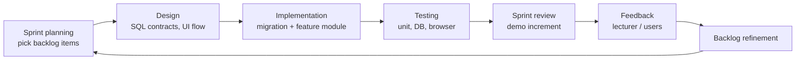

# Stage 2 – Process planning

## 2.1 Selected process model

**Agile using Scrum practices** (proposal §3.1). The team develops the product in five ordered sprints. Each sprint delivers a usable, demonstrable increment.

## 2.2 Justification

| Project characteristic | Why Scrum fits | Why a plan-driven model (Waterfall/V-model) fits worse |
| --- | --- | --- |
| Requirements refined through lecturer and stakeholder feedback | Backlog refinement at the end of every sprint absorbs change. Three changes (CF-22 withdrawal, CF-04 location, CF-14 invitations) were absorbed this way. | Changes after the requirements phase are expensive and need re-baselining |
| Five-member student team with a fixed deadline | Time-boxed sprints give regular checkpoints and visible progress | One big delivery at the end gives risky feedback very late |
| Security-sensitive, role-based system | Each sprint adds tests with its features, so defects are found early. The PT409 defect, for example, was found and fixed within Sprint 3. | Testing at the end finds design-level defects late |
| Needs early demonstrations (Milestones 1–3) | Working increments can be shown at every milestone | Working software appears only near the end |

Prototyping alone was rejected because the course requires documented requirements, design and testing artefacts. The Spiral model was rejected as too heavyweight in risk analysis for a five-person, one-semester project.

## 2.3 Development approach (per sprint)

The concrete engineering workflow used in each sprint:

1. Choose backlog items by MoSCoW priority and sprint order. Write or refine the user story and acceptance criteria.
2. Design the database contract first (tables, RLS, RPC signatures, error codes), then the UI flow.
3. Implement a new timestamped SQL migration. Never edit an applied migration. Implement the feature module in layers (`model → data → application → ui`).
4. Add tests at three levels: Vitest unit tests (validation rules), PGlite database tests (RLS and RPCs as non-privileged roles) and Playwright browser journeys.
5. Run the full verification set locally, then in GitHub Actions CI on every push.
6. For hosted changes, prepare an exact migration review (target, SQL, effects, validation, recovery) and apply it **only after explicit approval**.
7. Record the increment in a sprint document and update traceability.

## 2.4 Project plan

| Phase (proposal §3.4) | Main activities | Output | Status |
| --- | --- | --- | --- |
| Project definition | Problem, stakeholders, objectives, scope | Approved proposal | Done (Milestone 1) |
| Process planning | Select and justify Scrum, plan | This document | Done (Milestone 1) |
| Agile planning | Backlog, stories, criteria, sprint plan | [03-agile-planning.md](03-agile-planning.md) | Done (Milestone 2); refined |
| Requirements engineering | FR/NFR, use cases, traceability | [04-requirements-specification.md](04-requirements-specification.md) | Done (Milestone 3); refined |
| Design | Architecture, UML, DB, UI | [05-design.md](05-design.md) | Done |
| Implementation | Sprints 1–4 | Working software | Done for all Must and Should items |
| Testing | Unit, integration, system, acceptance | [07-test-report.md](07-test-report.md) | Automated suites done; deployed acceptance pending |
| Deployment | Configure and deploy | [08-deployment.md](08-deployment.md) | Prepared; **not yet deployed** |
| Maintenance | Lecturer-approved change request | [09-maintenance.md](09-maintenance.md) | Process ready; **awaiting the lecturer's change request** |
| Security | Threats and controls | [10-security.md](10-security.md) | Done |

## 2.5 Definition of Done

A backlog item is done only when all of the following hold:

- [ ] Its acceptance criteria are demonstrably met.
- [ ] Authorisation is enforced in the database (grants, RLS, RPC checks), not only in the UI.
- [ ] Input bounds are identical in the client schema (Zod) and SQL.
- [ ] Allow and deny tests exist (unit, database and a browser journey where there is UI).
- [ ] Loading, empty and error states are accessible.
- [ ] Lint (0 warnings), strict typecheck, all tests and the build pass locally and in CI.
- [ ] Generated database types are regenerated and match CI.
- [ ] Documentation and traceability are updated.

## 2.6 Tooling and configuration management

| Concern | Tool / practice |
| --- | --- |
| Version control | Git and GitHub ([razim2003/civic-flow](https://github.com/razim2003/civic-flow)). Feature branches merged to `main`. |
| Continuous integration | GitHub Actions `Verify CivicFlow` on every push and PR: install → lint → typecheck → unit → database tests → type-drift check → build → Playwright |
| Database change control | Ordered `supabase/migrations/*.sql`, never edited after being applied; hosted rollout only after explicit approval |
| Issue/backlog tracking | Backlog and status kept in [implementation-roadmap.md](../implementation-roadmap.md) and the RTM |
| Code quality | ESLint, strict TypeScript and generated DB types; feature-module boundaries |
| AI assistance | Permitted by guidelines §4; all generated output is reviewed, tested and documented by the team, as required |
