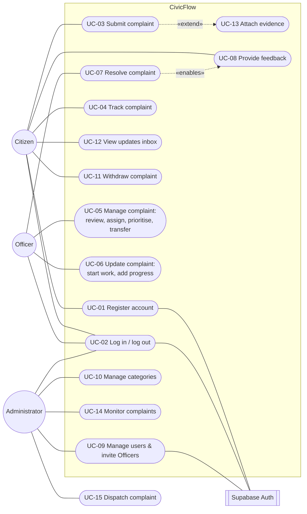

# Stage 4 – Requirements specification

Baseline: proposal §5 (pp. 11–16). This specification refines it into well-formed, testable requirements with stable IDs (CF-xx), measurable non-functional requirements, use cases and an end-to-end traceability matrix. The detailed working baseline and its decision history are in [requirements.md](../requirements.md).

## 4.1 Actors

| Actor | Kind | Description |
| --- | --- | --- |
| Citizen | Primary, application role | Registers, submits and tracks own complaints, receives updates, gives feedback, may withdraw an unresolved complaint |
| Public Service Officer | Primary, application role | Belongs to exactly one department. Reviews, assigns, prioritises and transfers complaints in that department. When assigned, starts work, adds progress and resolves. |
| Administrator | Primary, application role | Manages users and Officer invitations, manages service categories, views monitoring. Doesn't process complaints. |
| Supabase Auth | Secondary system actor | Stores credentials, verifies email, issues sessions, sends invitation and recovery emails |
| Map tile provider (OpenStreetMap) | Secondary system actor | Supplies map images for location selection |

Department managers are stakeholders, not a fourth role (proposal p. 12).

## 4.2 Functional requirements

Each requirement is atomic, testable and traced to the proposal page. "Verified by" names test-case IDs from the [test report](07-test-report.md).

| ID | Requirement ("The system shall …") | Priority | Source | Verified by |
| --- | --- | --- | --- | --- |
| CF-01 | … allow a visitor to register a Citizen account with name, email and a password of at least 12 characters, and shall assign the Citizen role only. | Must | p. 11 | TC-AUTH-02, TC-DB-FND-01 |
| CF-02 | … allow registered users to log in and log out, and shall deny protected pages and data after logout. | Must | p. 11 | TC-AUTH-03, TC-AUTH-06 |
| CF-03 | … enforce role-based access to every protected function in the database, independently of the user interface. | Must | p. 11 | TC-AUTH-04, TC-RBAC-01, TC-DB-FND-02…04 |
| CF-04 | … allow a Citizen to submit a complaint with a description (10–5,000 characters), location text (1–300) and a latitude/longitude selected on a map or entered as numbers. | Must | p. 11 | TC-SUB-01, TC-SUB-02, TC-DB-SUB-03 |
| CF-05 | … require the Citizen to select one active service category and shall route the complaint to that category's department. | Must | p. 11 | TC-SUB-04, TC-DB-SUB-01, TC-DB-SUB-07 |
| CF-06 | … generate a unique identifier for each complaint, set its initial status to Submitted and show a confirmation with its reference. | Must | p. 11 | TC-SUB-01, TC-DB-SUB-01 |
| CF-07 | … allow a Citizen to list, open and track only their own complaints, including status, progress and resolution. | Must | p. 11 | TC-TRK-01…03, TC-DB-SUB-06 |
| CF-08 | … allow an active Officer to view and open the complaints of their own department, and complaints assigned to them. | Must | p. 11 | TC-OFF-02, TC-DB-SUB-06 |
| CF-09 | … allow an Officer to assign a department complaint to an active Officer of the same department, and to transfer an unstarted complaint to another department with a reason. | Must | p. 11 | TC-OFF-01, TC-OFF-04, TC-DB-OFF-04, TC-DB-OFF-09 |
| CF-10 | … allow an Officer to set complaint priority to Low, Normal, High or Urgent. | Must | p. 11 | TC-OFF-01, TC-OFF-08 |
| CF-11 | … allow only valid status transitions (Submitted → Under review → In progress → Resolved) and allow only the assigned Officer to start work and record progress remarks. | Must | p. 11 | TC-OFF-01, TC-OFF-05, TC-DB-OFF-05 |
| CF-12 | … allow the assigned Officer to resolve an In progress complaint with resolution details (10–5,000 characters), storing the resolution date and Officer. | Must | p. 11 | TC-OFF-01, TC-DB-OFF-06 |
| CF-13 | … record a durable update for the Citizen with every complaint change, and shall let the Citizen list updates and mark them read. | Must | p. 11 | TC-NTF-01, TC-DB-NTF-01…05 |
| CF-14 | … allow an Administrator to view users, change role, department and active state, and invite Officer accounts. It shall audit every change and protect the last active Administrator. | Must | p. 11 | TC-ADM-01…03, TC-DB-ADM-01…04 |
| CF-15 | … allow every user to change their own display name only. | Should | p. 6 | TC-AUTH-08 |
| CF-16 | … allow a Citizen to attach up to five private JPEG/PNG/PDF files (≤ 5 MiB each) to their Submitted complaint, downloadable only by authorised users. | Should | p. 11 | TC-SUB-01, TC-DB-EV-01…06 |
| CF-17 | … allow searching by reference or description and filtering by status (Citizen), and by status, category, priority and assignment (Officer). | Should | p. 6 | TC-TRK-01, TC-OFF-02, TC-OFF-09 |
| CF-18 | … maintain an append-only history of every complaint change, visible to authorised users. | Should | p. 11 | TC-SUB-01, TC-DB-OFF-01 |
| CF-19 | … allow the owning Citizen to submit exactly one rating (1–5) with an optional comment (≤ 2,000 characters) on a Resolved complaint. | Should | p. 11 | TC-FB-01, TC-FB-02, TC-DB-FB-01…05 |
| CF-20 | … allow an Administrator to create, edit, route and deactivate service categories without deleting them, auditing every change. | Should | p. 11 | TC-CAT-01, TC-CAT-02, TC-DB-CAT-01…06 |
| CF-21 | … provide Administrators with read-only complaint monitoring information (counts by status, average rating). | Could | p. 11 | TC-MON-01, TC-U-MON-01 |
| CF-22 | … allow the owning Citizen to withdraw an unresolved complaint with a 10–2,000 character reason, retaining its record, evidence and history. *(approved scope extension)* | Should | change record | TC-WD-01…04, TC-DB-WD-01…05 |

| CF-23 | … automatically assign each new complaint to the active Officer with the fewest open assignments in the routed department, and notify that Officer. *(CR-006)* | Must | CR-006 | TC-DB-DSP-01…03, TC-DSP-03 |
| CF-24 | … allow an active Administrator to dispatch an open complaint: route it to another active department/category and/or assign an active Officer of that department, with a recorded 10–2,000 character reason. *(CR-006)* | Must | CR-006 | TC-DSP-01, TC-DB-DSP-04…09 |
| CF-25 | … apply a service-level target per priority (urgent 1 day, high 3, normal 7, low 14), flag open complaints that are due soon or overdue, and report on-target resolution. *(CR-006)* | Should | CR-006 | TC-U-SLA-01, TC-DSP-02, TC-DSP-03 |

That is 25 functional requirements, above the minimum of 12. CF-23…25 were added by change request CR-006 after a coverage gap was found in use ([sprint-5.md](../sprint-5.md)).

## 4.3 Non-functional requirements

The proposal's quality goals (p. 12) are refined into measurable statements. *Target status*: **Verified** means an automated check enforces it. **Pending** means it needs the deployed environment. Numbers marked *proposed* are team targets, not proposal commitments.

| ID | Category | Requirement | Measure / acceptance threshold | Verification method | Status |
| --- | --- | --- | --- | --- | --- |
| NFR-01 | Performance | List screens shall load a bounded page of results, never the whole table. | Citizen/Officer lists ≤ 10 rows per request; admin users ≤ 20; ownership, department and status columns indexed | Code review of `range()` calls; indexes in migration 001 | Verified |
| NFR-02 | Performance | Common screens should be usable quickly on the demo deployment. | *Proposed:* first meaningful content ≤ 3 s and page navigation ≤ 1.5 s on a typical broadband connection with demo data | Manual timing in browser DevTools on the deployed URL | Pending (deployment) |
| NFR-03 | Usability / accessibility | Forms shall be usable by keyboard and screen reader, and pages shall fit a phone screen. | Every input has a programmatic label; errors announced (`role="alert"`); skip link; no horizontal scroll at 375 px width | Playwright `getByLabel`/role queries; mobile overflow tests TC-UX-01, TC-TRK-01, TC-OFF-06 | Verified |
| NFR-04 | Security – authentication | Protected functions shall require an authenticated, active account. | 100% of RPCs deny the anonymous role; inactive accounts denied immediately | TC-DB-FND-03, TC-DB-ADM-04, security advisor | Verified |
| NFR-05 | Security – authorisation | Users shall access only data and actions permitted by role, ownership and department. | RLS enabled on 9/9 application tables; 0 direct browser INSERT/UPDATE/DELETE grants | TC-DB-FND-02, TC-DB-OFF-03, TC-DB-FB-05 | Verified |
| NFR-06 | Reliability / integrity | Every complaint change shall be atomic and concurrency-safe. | Each version change writes exactly 1 event and 1 notification, or nothing; stale writes rejected (HTTP 409); retries are idempotent | TC-DB-SUB-05, TC-DB-OFF-08, TC-DB-WD-05, TC-INT-04…06 | Verified |
| NFR-07 | Data integrity / validation | Invalid or incomplete records shall be rejected in both client and database. | Identical bounds in Zod schemas and SQL CHECK/RPC validation | Unit TC-U-* and database TC-DB-*-bounds tests | Verified |
| NFR-08 | Availability | The deployed system shall be reachable during the evaluation. | Smoke-test checklist (08 §8.6) passes within 24 h before the demo | Manual smoke test | Pending (deployment) |
| NFR-09 | Maintainability | Code shall be modular and consistently checked. | Feature modules with ui/application/model/data layers; ESLint 0 warnings; strict TypeScript; CI green on `main` | CI workflow | Verified |
| NFR-10 | Scalability / extensibility | New categories, departments and users shall be added without code changes. | Category added via the UI appears in the Citizen form | TC-CAT-01, TC-DB-CAT-02 | Verified |
| NFR-11 | Privacy | Complaint data and evidence shall be visible only to authorised users; demo data is fictional. | Evidence bucket private; no public complaint feed; tests use fictional identities | TC-DB-EV-01, TC-TRK-03, security review | Verified |

## 4.4 Use case diagram

## 4.5 Use case descriptions

### UC-03 Submit complaint (CF-04, 05, 06, 16)
- **Actor:** Citizen. **Precondition:** signed in with an active Citizen account; at least one active category exists.
- **Main flow:** 1) Open *Make a complaint*. 2) Select a service category. 3) Describe the issue. 4) Select a location on the map, enter coordinates or use *Use my current location*, then describe the location. 5) Submit. 6) The system validates the input, derives the owner and department, creates the complaint with status Submitted, history event #1 and an update, and shows the reference. 7) Optionally attach evidence (UC-13).
- **Alternative flows:** 3a/4a invalid or missing fields: field errors are shown and nothing is saved. 5a network failure: the same request key is retried and no duplicate is created. 7a upload fails: the complaint stays saved and the file can be retried.
- **Exceptions:** the category became inactive: "category no longer available". Caller isn't an active Citizen: refused.
- **Postcondition:** the complaint exists, is Submitted and is visible only to its owner and the routed department.

### UC-04 Track complaint (CF-07, 17, 18)
- **Actor:** Citizen. **Precondition:** signed in.
- **Main flow:** 1) Open *My complaints*. 2) Optionally search by reference or description and filter by status. 3) Open a complaint. 4) View status steps, details, location, evidence, resolution and history.
- **Exception:** the reference doesn't exist or belongs to someone else: "Complaint unavailable", with no details revealed.

### UC-05 Manage complaint (CF-08, 09, 10)
- **Actor:** Officer. **Precondition:** active Officer in an active department; the complaint is in that department and not Resolved or Withdrawn.
- **Main flow:** 1) Open the *Department complaints* queue and filter. 2) Open a complaint. 3) *Begin review* (Submitted → Under review). 4) Assign it to an Officer of the department. 5) Set priority. Each step saves one history event and one Citizen update.
- **Alternative:** 4a transfer to another department/category (Submitted or Under review only, reason required). The assignee is cleared and the old department loses access.
- **Exceptions:** the complaint changed meanwhile: stale-version message and the input is kept. Target Officer not active or not in the department: refused.

### UC-06 Update complaint (CF-11)
- **Actor:** assigned Officer. **Precondition:** status Under review (to start) or In progress (to add progress).
- **Main flow:** 1) Open the complaint. 2) *Start work*, optionally with a remark. 3) *Add progress update* with a 1–2,000 character remark. 4) Save. The Citizen sees the remark in history and Updates.
- **Exceptions:** not the assignee: refused. Invalid transition: refused. Empty remark: refused.

### UC-07 Resolve complaint (CF-12)
- **Actor:** assigned Officer. **Precondition:** status In progress.
- **Main flow:** 1) Choose *Resolve*. 2) Enter resolution details (10–5,000 characters). 3) Tick the confirmation. 4) Save. The status becomes Resolved, the date and Officer are stored, and the Citizen receives a "Complaint resolved" update.
- **Exception:** details are too short or missing: refused atomically, with no partial update.

### UC-08 Provide feedback (CF-19)
- **Actor:** Citizen (owner). **Precondition:** the complaint is Resolved and has no feedback yet.
- **Main flow:** 1) Open the resolved complaint. 2) Choose a 1–5 rating. 3) Optionally add a comment. 4) Submit. The feedback is shown read-only to the owner, and to the department's Officers and Administrators.
- **Exceptions:** no rating: client error. Already submitted: "Feedback was already submitted". Not resolved: refused.

### UC-09 Manage users and invite Officers (CF-14)
- **Actor:** Administrator. **Main flow:** 1) Open *User management*. 2) Search users. 3) Edit role, department or active state, or choose *Create Officer account* (name, email, department). The invitation is emailed and the recipient sets their own password. 4) Save. The change is audited.
- **Exceptions:** removing the last active Administrator: refused. An Officer with open assignments can't be moved or deactivated until those complaints are reassigned.

### UC-10 Manage categories (CF-20)
- **Actor:** Administrator. **Main flow:** 1) Open *Service categories*. 2) *New category* or *Edit*. 3) Enter a name, an optional description and the receiving department, and set *Available for new complaints*. 4) Save. The change is audited, and active categories appear in the Citizen form.
- **Exceptions:** duplicate name; inactive department for an active category; changing the department of a category that already has complaints. Each is refused with an explanation.

### UC-11 Withdraw complaint (CF-22)
- **Actor:** Citizen (owner). **Precondition:** status Submitted, Under review or In progress.
- **Main flow:** 1) Open the complaint. 2) Choose *Withdraw complaint*. 3) Give a reason (10–2,000 characters). 4) Confirm. The status becomes Withdrawn (final), the assignment is released, and the record, evidence and history are kept.
- **Exceptions:** stale page: refresh required. Already final: refused.

### UC-12 View updates inbox (CF-13)
- **Actor:** Citizen. **Main flow:** 1) The navigation badge shows the unread count. 2) Open *Updates*. 3) Read items (newest first). 4) *Mark as read*, or *Mark all as read*. 5) *View complaint* opens the detail page and marks the item read.

### UC-15 Dispatch complaint (CF-24)
- **Actor:** Administrator. **Precondition:** the complaint is Submitted, Under review or In progress.
- **Main flow:** 1) Open the *Dispatch centre*. Coverage cards show departments with no Officers, and the *Needs attention* filter lists complaints that are unstaffed, unassigned or past target. 2) Choose *Dispatch*. 3) Select the department, a category of that department and optionally an Officer. 4) Enter a reason and confirm. The history gains a *Transferred* or *Officer assigned* event by the Administrator, and the citizen and new Officer are notified.
- **Exceptions:** work in progress can't change department or lose its assignee. The complaint changed meanwhile: refresh. Closed complaints: refused.

UC-01 (register), UC-02 (log in/out), UC-13 (attach evidence) and UC-14 (monitor) follow the proposal descriptions. Their flows are in the [user guide](user-guide.md).

## 4.6 Prioritisation (MoSCoW)

The priorities are those of the proposal (p. 14–15) and are unchanged. **Must:** CF-01…CF-14. **Should:** CF-15…CF-20, plus CF-22 (team-assigned to the approved extension). **Could:** CF-21. **Won't (initial release):** AI classification, GPS officer tracking, payments, emergency response, broad government integration. MoSCoW was chosen because it maps directly onto sprint order: all Must items were scheduled before Should items in the same sprint, and the Could item was delivered only in minimal form.

## 4.7 Requirements traceability matrix

Columns: requirement → user story → use case → design artefact → implementation → tests → status. Migration numbers are abbreviated: 001 = `20261019000100_foundation.sql` … 014 = `20261029000300_category_management.sql` (full list in [database-operations.md](../database-operations.md)).

| Req | Story | Use case | Design | Implementation (DB → frontend) | Tests | Status |
| --- | --- | --- | --- | --- | --- | --- |
| CF-01 | US-01 | UC-01 | Auth flow, `handle_new_user` trigger | 001 trigger → `features/auth` | TC-AUTH-02, TC-U-AUTH-01, TC-DB-FND-01 | Done |
| CF-02 | US-02 | UC-02 | Memory-only session decision | Supabase Auth → `features/auth/AuthProvider` | TC-AUTH-03, TC-AUTH-06, TC-U-AUTH-02 | Done |
| CF-03 | US-03 | all | Access matrix ([DB design](../database-design.md#access-matrix)) | 001–002 RLS, `private.active_role` → route guards | TC-AUTH-04, TC-RBAC-01, TC-DB-FND-02…04 | Done |
| CF-04 | US-04 | UC-03 | Seq. SD-1, `shared/location` | 004 `submit_complaint` → `complaints/NewComplaintPage` | TC-SUB-01…02, TC-LOC-01…02, TC-U-CMP-01, TC-DB-SUB-03 | Done |
| CF-05 | US-05 | UC-03 | Category routing | 004, 006 → category selector | TC-SUB-04…05, TC-DB-SUB-07 | Done |
| CF-06 | US-06 | UC-03 | SD-1 | 004 → submission success view | TC-SUB-01, TC-SUB-03, TC-DB-SUB-01…02 | Done |
| CF-07 | US-07 | UC-04 | Citizen screens | 004 RLS → `MyComplaintsPage`, `ComplaintDetailPage` | TC-TRK-01…03 | Done |
| CF-08 | US-08 | UC-05 | Officer screens | 004 RLS → `officer/OfficerQueue` | TC-OFF-02, TC-OFF-07 | Done |
| CF-09 | US-09 | UC-05 | State diagram, SD-2 | 009 `assign_complaint`, `transfer_complaint` → `OfficerActions` | TC-OFF-01, TC-OFF-04, TC-DB-OFF-04, TC-DB-OFF-09 | Done |
| CF-10 | US-10 | UC-05 | — | 009 `set_complaint_priority` | TC-OFF-01, TC-OFF-08 | Done |
| CF-11 | US-11 | UC-06 | Activity diagram, state diagram | 009 `review/start/add_progress` | TC-OFF-01, TC-OFF-03, TC-OFF-05, TC-DB-OFF-01…05 | Done |
| CF-12 | US-12 | UC-07 | SD-2 | 010 `resolve_complaint` | TC-OFF-01, TC-DB-OFF-06…07 | Done |
| CF-13 | US-13 | UC-12 | `notifications` table | 004/009 writes, 013 read policy + `mark_notifications_read` → `features/notifications` | TC-NTF-01, TC-U-NTF-01, TC-DB-NTF-01…05 | Done |
| CF-14 | US-14 | UC-09 | Admin audit, Edge Function | 002 `admin_update_user`, `provision-officer` → `features/admin` | TC-ADM-01…03, TC-U-INV-01, TC-DB-ADM-01…04, TC-INT-08 | Done |
| CF-15 | US-15 | — | — | 002 `update_my_profile` → `features/profiles` | TC-AUTH-08 | Done |
| CF-16 | US-16 | UC-13 | Evidence storage design | 005 bucket, policies, reserve/finalize → `features/evidence` | TC-SUB-01, TC-U-EV-01, TC-DB-EV-01…06 | Done |
| CF-17 | US-07, US-08 | UC-04, UC-05 | — | Data adapters (bounded `ilike`, filters) | TC-TRK-01, TC-OFF-02, TC-OFF-09 | Done |
| CF-18 | US-17 | UC-04 | `complaint_events` | 004–011 event writes → timeline | TC-SUB-01, TC-DB-OFF-01 | Done |
| CF-19 | US-18 | UC-08 | SD-3, `complaint_feedback` | 012 `submit_feedback` → `features/feedback` | TC-FB-01…02, TC-U-FB-01, TC-DB-FB-01…05 | Done |
| CF-20 | US-19 | UC-10 | Category rules | 014 `admin_upsert_category` → `features/categories` | TC-CAT-01…02, TC-U-CAT-01, TC-DB-CAT-01…06 | Done |
| CF-21 | US-21 | UC-14 | Analytics view | 015 `admin_analytics`, `community_impact` → `features/analytics`, `admin/AdminOverview` | TC-MON-01, TC-DSP-02, TC-U-MON-01, TC-U-ANL-01, TC-DB-DSP-10…12 | Done (enhanced) |
| CF-23 | US-22 | UC-03 | SD-4 | 015 `submit_complaint`, `private.pick_officer` | TC-DB-DSP-01…03, TC-DSP-03 | Done |
| CF-24 | US-23 | UC-15 | SD-4 | 015 `admin_dispatch_complaint` → `features/dispatch` | TC-DSP-01, TC-U-DSP-01, TC-DB-DSP-04…09 | Done |
| CF-25 | US-24 | UC-05, UC-15 | SLA table | `shared/sla.ts` + `private.sla_hours` | TC-U-SLA-01, TC-DSP-02, TC-DSP-03 | Done |
| CF-22 | US-20 | UC-11 | State diagram | 007–008, 011 `withdraw_complaint` → `WithdrawalPanel` | TC-WD-01…04, TC-U-WD-01, TC-DB-WD-01…05 | Done |
| NFR-04/05 | US-03 | all | [Security](10-security.md) | Grants, RLS, definer RPCs | TC-DB-FND-*, TC-INT-* | Done |
| NFR-06 | — | — | Lock order, version checks | All workflow RPCs | TC-DB-*-rollback, TC-INT-04…06 | Done |

## 4.8 Requirements validation record

| Activity | What was done | Outcome |
| --- | --- | --- |
| Proposal review | The proposal (Milestones 1–3) was submitted as the requirements baseline | Accepted as the baseline for development. The lecturer's written comments are **to be attached by the team if received**. |
| Stakeholder refinement | The project owner requested CF-22 withdrawal (2026-10-19), Administrator-created Officers (2026-10-20) and the location refinement (2026-10-21) | Recorded as change records with impact analysis (see 09) |
| Prototype walkthroughs | Each increment was demonstrated in the browser and screenshots reviewed (sprint records) | Defects such as the empty category list found and fixed |
| Consistency checks | Client and database bounds compared; tests assert both | No mismatches outstanding |
| **Not yet done** | Validation with real citizens or officers; lecturer sign-off of the refined requirements | These assumptions remain **unvalidated** and are labelled as such |
