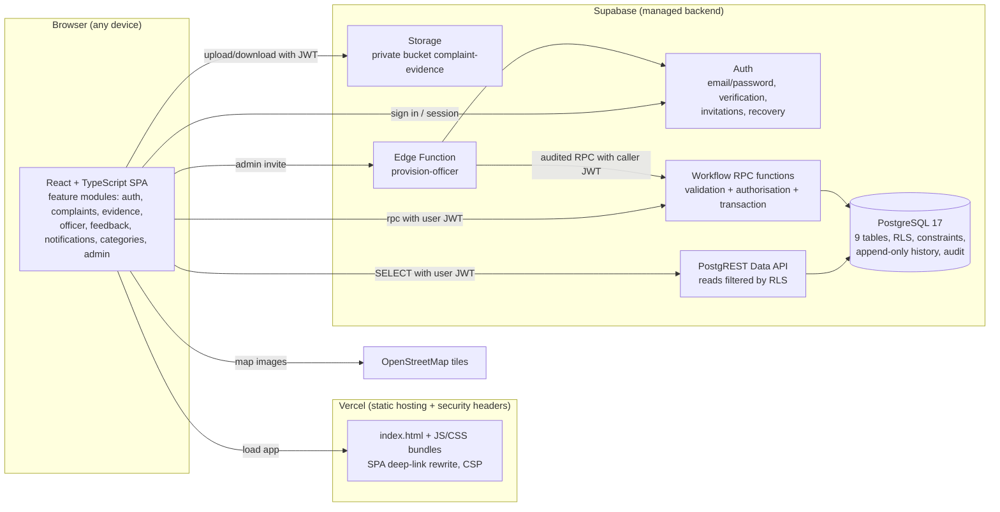
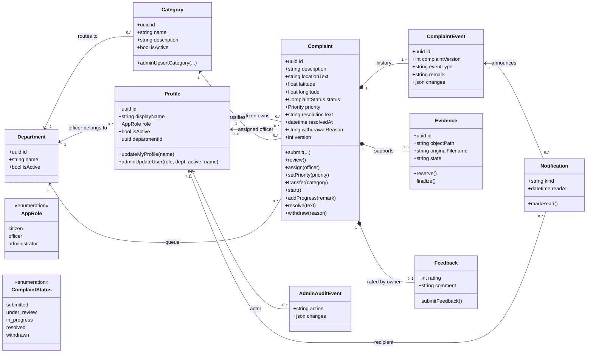
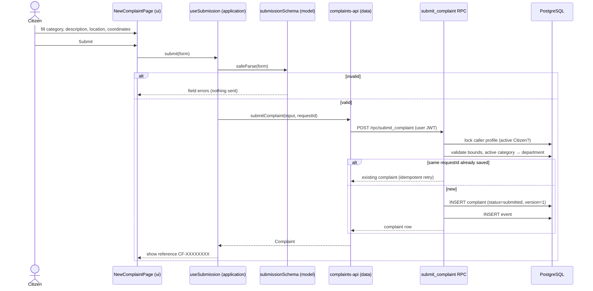
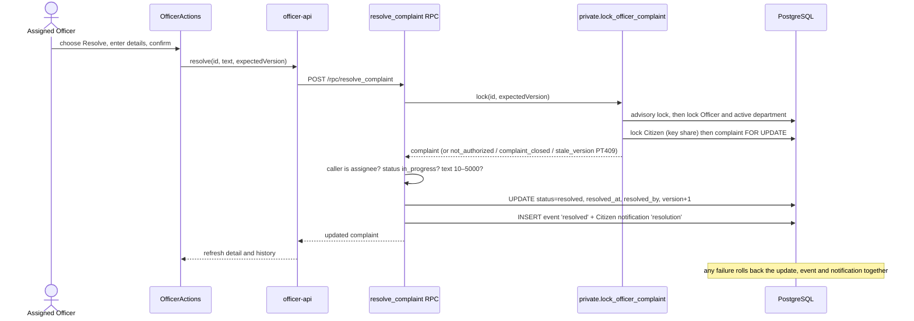
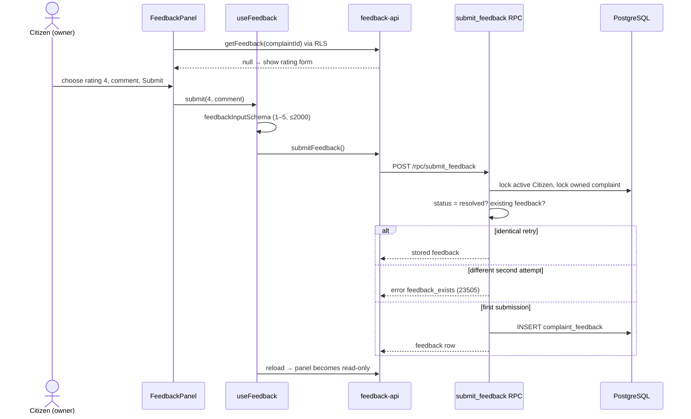
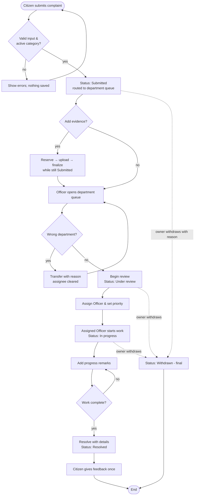
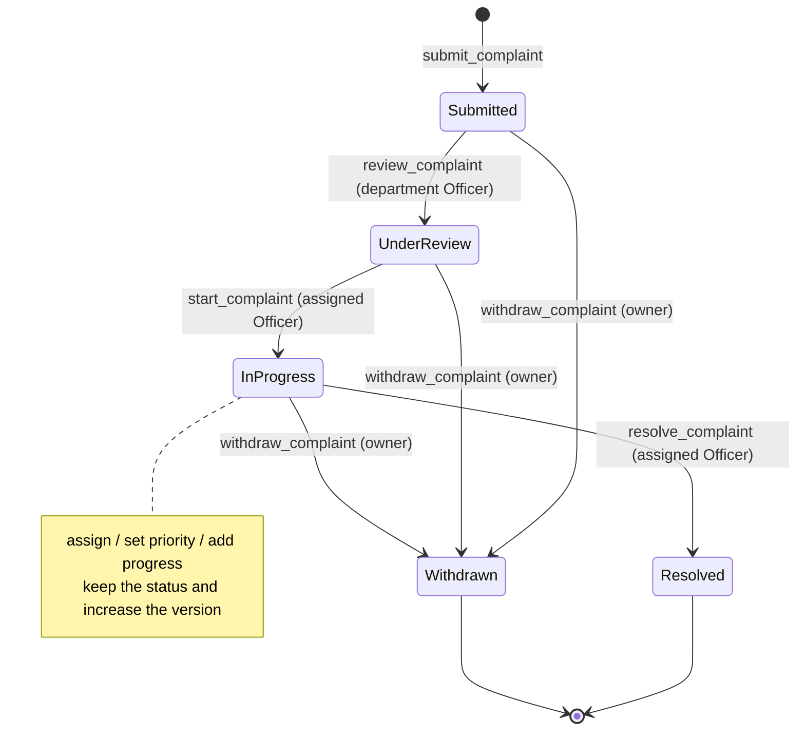
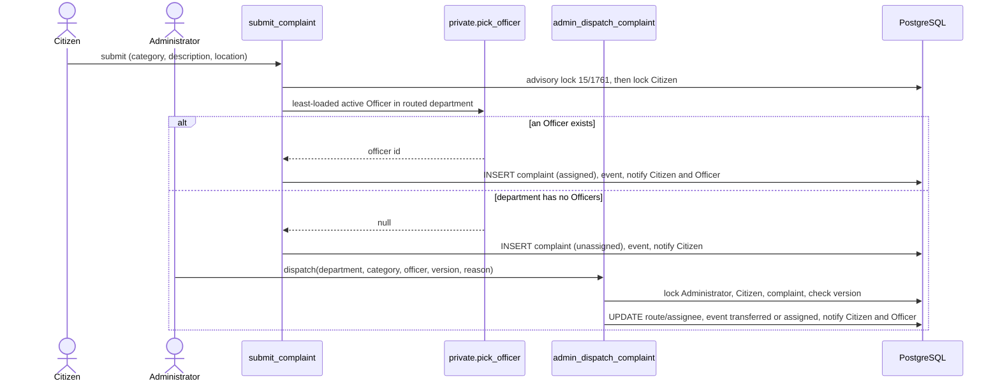

# Stage 5 – System design

Detailed design records: [architecture.md](../architecture.md) (layers, flows, deployment, threat controls) and [database-design.md](../database-design.md) (tables, access matrix, function contracts, evidence storage). This document collects the design views the guidelines require (§7) and explains the main decisions.

## 5.1 High-level architecture

CivicFlow is a **single-page web application with a managed backend** (a three-tier, client–server architecture):

**Trust boundary:** the browser is untrusted. Every authorisation decision is made in PostgreSQL (grants, Row Level Security and checks inside `SECURITY DEFINER` functions) or in Storage policies. Route guards and hidden buttons are only for usability.

**Frontend layering (per feature):** `ui/` (React pages) → `application/` (hooks and use cases) → `model/` (pure types, Zod validation, rules) and `data/` (the only place that calls Supabase). Features import each other only through `index.ts`.

## 5.2 Class / domain model

Domain entities (database tables) with their key attributes and the operations that may change them. Operations are the only write paths; browsers have no direct INSERT/UPDATE/DELETE.

## 5.3 Sequence diagrams

### SD-1 Submit complaint (UC-03)

### SD-2 Officer resolves a complaint (UC-07)

### SD-3 Citizen gives feedback (UC-08)

## 5.4 Activity diagram – complaint processing workflow

Every arrow that changes status or assignment writes a history event and a Citizen update in the same database transaction.

## 5.5 State machine – complaint status

## 5.6 Database / ER design

Nine tables: `profiles`, `departments`, `categories`, `complaints`, `complaint_events`, `complaint_evidence`, `complaint_feedback`, `notifications`, and `private.admin_audit_events`. The ER diagram, column rules, access matrix and function contracts are in [database-design.md](../database-design.md). Key integrity rules:

- Resolution fields are set **if and only if** the status is Resolved. Withdrawal fields are set if and only if it is Withdrawn. In progress and Resolved require an assignee.
- `(complaint_id, complaint_version)` is unique, so there is exactly one history event per version.
- `(recipient_id, event_id)` is unique, so a notification is never duplicated.
- Feedback has the complaint as its primary key, so there is at most one per complaint.
- Foreign keys are `ON DELETE RESTRICT` everywhere. The application deletes nothing.

## 5.7 User-interface prototype

The UI was prototyped directly as working screens (no separate wireframing tool) and reviewed at desktop and 375 px mobile widths. The screenshots below come from the automated browser tests with fictional data (`CAPTURE_SCREENS=1 npx playwright test`).

| # | Screen | Role | Screenshot |
| --- | --- | --- | --- |
| 1 | Sign in | All | [01-sign-in.png](screens/01-sign-in.png) |
| 2 | Citizen overview (counts, recent complaints) | Citizen | [02-citizen-overview.png](screens/02-citizen-overview.png) |
| 3 | Make a complaint (category, description, map, coordinates) | Citizen | [03-citizen-new-complaint.png](screens/03-citizen-new-complaint.png) |
| 4 | Complaint detail (progress steps, location, evidence, history) | Citizen | [04-citizen-complaint-detail.png](screens/04-citizen-complaint-detail.png) |
| 5 | My complaints (search, status filter, pagination) | Citizen | [05-citizen-my-complaints.png](screens/05-citizen-my-complaints.png) |
| 6 | Resolved complaint with feedback | Citizen | [06-citizen-resolved-feedback.png](screens/06-citizen-resolved-feedback.png) |
| 7 | Updates inbox (unread badge, mark read) | Citizen | [07-citizen-updates-inbox.png](screens/07-citizen-updates-inbox.png) |
| 8 | Officer overview (department counts) | Officer | [08-officer-overview.png](screens/08-officer-overview.png) |
| 9 | Department queue (filters) | Officer | [09-officer-department-queue.png](screens/09-officer-department-queue.png) |
| 10 | Process complaint (action selector, guidance) | Officer | [10-officer-process-complaint.png](screens/10-officer-process-complaint.png) |
| 11 | Resolved complaint (closed processing) | Officer | [11-officer-resolved.png](screens/11-officer-resolved.png) |
| 12 | Administrator overview with monitoring | Administrator | [12-admin-overview-monitoring.png](screens/12-admin-overview-monitoring.png) |
| 13 | Service categories | Administrator | [13-admin-service-categories.png](screens/13-admin-service-categories.png) |
| 14 | Dispatch centre (coverage, needs-attention filter) | Administrator | [14-admin-dispatch-centre.png](screens/14-admin-dispatch-centre.png) |
| 15 | Service analytics (light / dark) | Administrator | [15-admin-analytics.png](screens/15-admin-analytics.png), [17-admin-analytics-dark.png](screens/17-admin-analytics-dark.png) |
| 16 | Department map | Officer | [16-officer-department-map.png](screens/16-officer-department-map.png) |
| 0 | Public landing page | Visitor | [00-landing.png](screens/00-landing.png) |

UI principles: one primary action per screen; plain-language status names; every form field labelled with its hint and error text; status shown as both text and colour; a skip-link and visible focus; and all user-supplied text rendered as plain text, never HTML.

### SD-4 Auto-assignment and Administrator dispatch (CR-006)

### Visual design system

The redesign uses a deliberate "civic signal" language rather than generic dashboard styling:

- **Palette and type:** warm paper surfaces, deep municipal green, and signal orange for anything that needs action. Bricolage Grotesque for headings and Public Sans for body text (self-hosted, so the strict CSP stays intact).
- **Complaints as service tickets:** a dashed perforation and notches.
- **Progress as a transit line:** the line fills between stations.
- **Motion:** page transitions, staggered lists, count-up figures and drawing route lines. All of it is disabled under `prefers-reduced-motion`.
- **Dark mode:** selected from the same tokens, not inverted. Chart series use a palette validated for both modes.

## 5.8 Design decisions and justification

| Decision | Alternatives considered | Reason |
| --- | --- | --- |
| **React + TypeScript + Vite** SPA | Server-rendered (Next.js), plain JS | Typed domain models catch errors at build time. Vite gives fast builds. The team already knew React. An SPA is enough because there is no SEO requirement. |
| **Supabase** (PostgreSQL, Auth, Storage) instead of a custom API server | Node/Express + MySQL; Firebase | Relational integrity (FKs, CHECKs, transactions) suits a workflow with history. RLS puts authorisation next to the data. Managed Auth avoids storing passwords ourselves. The free tier fits the project. |
| **Business writes only through `SECURITY DEFINER` RPCs**; direct table DML revoked | Direct table updates with RLS UPDATE policies | A status change must update the complaint, history and notification atomically with transition rules and locks. Generic UPDATE policies can't express "only valid transitions". |
| **Optimistic concurrency** (`expected_version`, error `PT409`) | Last-write-wins | Two Officers editing the same complaint must not overwrite each other silently. PT409 maps to HTTP 409 without PostgREST retry loops (defect DEF-01). |
| **Append-only history + durable notifications** in PostgreSQL | Realtime push, email/SMS | Meets CF-13/18 within the scope constraint on external notifications. History is the audit trail. |
| **Memory-only sessions** (`persistSession: false`) | localStorage tokens | Avoids leaving bearer tokens in persistent storage on shared computers. Trade-off: a page refresh requires signing in again (documented). |
| **Private evidence bucket** with server-reserved paths | Public bucket, signed URLs | Complaint evidence may contain personal information. Paths can't be chosen by users, and downloads are authorised per request. |
| **Department-scoped Officers; assigned-Officer-only progress/resolution** | Any Officer can edit any complaint | Least privilege and clear accountability, as the problem statement asks ("identifying responsible officers"). |
| **Categories deactivated, never deleted; referenced department immutable** | Hard delete / free edit | Historic complaints must keep their original routing and meaning. |
| **Leaflet + OpenStreetMap** with numeric coordinate fallback | Google Maps | No API key or cost. Accessible fallback when tiles fail. The OSM attribution policy is respected. |
| **Vercel** static hosting | Netlify, GitHub Pages | Simple Vite deployment, SPA rewrites and security headers configured in `vercel.json`. |
| **Auto-assignment + Administrator dispatch** (CR-006) | Manual pick-up only; giving Administrators full workflow rights | Guarantees an owner whenever staff exist, and gives a narrow, audited escape hatch when they don't, without making Administrators process complaints. |
| **`motion` library + CSS tokens** | Hand-written CSS only; heavy UI kits | Declarative, interruptible animations that respect reduced motion. Design tokens keep light and dark themes consistent. |
| **Vitest + PGlite + Playwright** | Jest only, manual testing | Tests each layer: pure rules, real SQL/RLS inside PostgreSQL, and user journeys in a real browser. |
