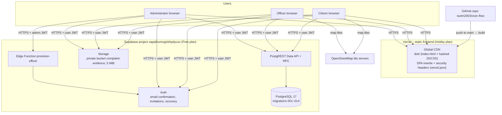

# Stage 8 – Deployment

> **Status (2026-10-29): not yet deployed.** The application builds and the hosting configuration is ready, but no Vercel deployment exists yet. Do not claim deployment until §8.6 has passed on a live URL. Record that URL in §8.7.

## 8.1 Deployment architecture



- **Frontend:** a static build. No server code runs on Vercel, and no secret is present in the frontend.
- **Backend:** Supabase. The database is changed only by version-controlled migrations.
- **Configuration:** only two **public** variables are needed in the browser: `VITE_SUPABASE_URL` and `VITE_SUPABASE_PUBLISHABLE_KEY`. Security comes from RLS, not from hiding these values.

## 8.2 System requirements

| Component | Requirement |
| --- | --- |
| End users | A current Chrome, Edge, Firefox or Safari; JavaScript enabled; internet access. Works on phones (≥ 375 px wide). |
| Developer machine | Node.js **≥ 22.18** with npm 10; Git; optional Docker Desktop (for `test:integration`) and the Supabase CLI |
| Hosting | A Vercel account linked to the GitHub repository; a Supabase project |

## 8.3 Configuration

| Setting | Where | Value / note |
| --- | --- | --- |
| `VITE_SUPABASE_URL` | `.env.local` (local) / Vercel Environment Variables | `https://xapqfnumcpjckhpdyuxz.supabase.co` |
| `VITE_SUPABASE_PUBLISHABLE_KEY` | same | The project's **publishable** key (`sb_publishable_…`). **Never** use the secret or service-role key. |
| Auth → URL configuration | Supabase dashboard | Site URL = the deployed URL. Redirect allow-list: `<deployed>/auth/callback`, `<deployed>/reset-password`, `<deployed>/accept-invite`, plus the local `127.0.0.1:5173` equivalents. |
| Auth → providers | Supabase dashboard | Email with confirmation on; minimum password length 12; anonymous sign-ins **off** |
| `CIVICFLOW_APP_URL` | Supabase Edge Function secrets | The deployed origin, so Officer invitation links point to it |
| SMTP | Supabase Auth | Custom SMTP is required to invite Officers at arbitrary email addresses. The default sender only delivers to project-team addresses. |
| Security headers | `vercel.json` (already in the repo) | CSP, `X-Frame-Options: DENY`, `nosniff`, `Referrer-Policy` |

## 8.4 Local installation

```bash
git clone https://github.com/razim2003/civic-flow.git
cd civic-flow
npm ci
cp .env.example .env.local   # then set the two public values
npm run dev                  # http://127.0.0.1:5173
```

On Windows PowerShell use `npm.cmd` if script execution is blocked. Verify the installation with the commands in [07 §7.1](07-test-report.md#71-test-plan).

## 8.5 Deployment steps

**A. Database (once per new migration, only after explicit approval)**

1. Review the pending migration files and their SHA-256 hashes (for Sprint 4, see [sprint-4.md](../sprint-4.md)).
2. Run a dry run against the linked project:

   ```bash
   supabase db push --linked --project-ref xapqfnumcpjckhpdyuxz --skip-vault --dry-run
   ```

3. Take a read-only baseline: `supabase/operations/inspect-*.sql`.
4. Apply:

   ```bash
   supabase db push --linked --project-ref xapqfnumcpjckhpdyuxz --skip-vault
   ```

5. Verify migration history, function grants, RLS and unchanged data checksums. Then check that anonymous REST calls return 401.

**B. Edge Function (already deployed; redeploy only if changed)**

```bash
supabase functions deploy provision-officer --project-ref xapqfnumcpjckhpdyuxz
```

**C. Frontend on Vercel**

1. In Vercel: **Add New → Project → Import** `razim2003/civic-flow`. The framework preset is detected as Vite (the build command and `dist` output come from `vercel.json`).
2. Add the two `VITE_*` environment variables for *Production* (and *Preview*, if previews should reach the same demo backend).
3. Deploy. Vercel builds `npm run build` on every push to `main`.
4. Copy the production URL into Supabase Auth URL configuration and into `CIVICFLOW_APP_URL`, then redeploy the function's secrets if needed.
5. Run the smoke test (§8.6).

Alternatively, with the CLI:

```bash
npm i -g vercel
vercel link
vercel env add VITE_SUPABASE_URL
vercel env add VITE_SUPABASE_PUBLISHABLE_KEY
vercel --prod
```

## 8.6 Smoke-test and acceptance checklist

Run this on the deployed URL with **fictional demo accounts** (never real citizens' data). Record the date, the tester and the result for each row.

| # | Check | Expected | Result |
| --- | --- | --- | --- |
| S1 | Open `/` and `/workspace` signed out | Redirect to sign-in | |
| S2 | Deep link `/complaints/new` reloads | SPA loads (no 404) and asks to sign in | |
| S3 | Response headers | CSP, `X-Frame-Options: DENY`, `nosniff` present | |
| S4 | Register a demo Citizen; confirm email; sign in | Citizen workspace | |
| S5 | Submit a complaint with a map location and a small PNG | Reference shown; file downloadable | |
| S6 | Officer (demo) reviews, assigns, starts, adds progress, resolves | Each step in history | |
| S7 | Citizen sees the Updates badge, opens the inbox, marks it read | Badge clears | |
| S8 | Citizen gives feedback (rating 4) | Read-only feedback shown; Officer can see it | |
| S9 | Admin creates a category; Citizen form shows it | Category appears | |
| S10 | Admin overview counts | Match the demo data | |
| S11 | Citizen opens another user's complaint URL | "Complaint unavailable" | |
| S12 | Page load timing (DevTools, broadband) | NFR-02 targets met | |

## 8.7 Deployment record

| Date | Environment | URL | Commit | Migrations applied | Smoke test | By |
| --- | --- | --- | --- | --- | --- | --- |
| — | Production (Vercel) | *to be filled* | | 001–011 (014 pending approval) | | |

## 8.8 Demonstration script (final evaluation)

1. Problem and stakeholders (01). 2. Backlog and a user story with its acceptance criteria (03). 3. Scrum process and sprint history (02, 03). 4. Architecture and sequence diagram SD-2 (05). 5. Live demo on the deployed URL: Citizen submits → Officer processes and resolves → Citizen sees the update and gives feedback → Admin views monitoring and adds a category. 6. Run `npx playwright test tests/e2e/sprint4.spec.ts` and show a database test refusing a direct `UPDATE` (07). 7. Maintenance change request (09). 8. Security controls: try opening another citizen's complaint and show the RLS refusal (10).
