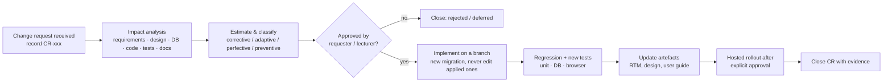

# Stage 9 – Maintenance and change requests

> **The lecturer's change request (guidelines §11) has not been received yet.** §9.4 is the template to complete when it arrives. The change requests in §9.3 are real changes already handled during development. They show the team's maintenance process, but they do **not** replace the lecturer-provided change request.

## 9.1 Maintenance process

Classification definitions: **corrective** fixes a defect; **adaptive** responds to a changed environment (platform, API, regulation); **perfective** adds or improves functionality, usability or performance in response to users; **preventive** reduces future risk or improves maintainability without visible behaviour change.

## 9.2 Change request register

| CR | Title | Requested by / date | Type | Status |
| --- | --- | --- | --- | --- |
| CR-001 | Citizen can withdraw an unresolved complaint (CF-22) | Project owner, 2026-10-19 | Perfective | Implemented, deployed to DB, tested |
| CR-002 | Stale-version conflicts must not loop (PT409) | Found by testing, 2026-10-21 | Corrective | Implemented, applied, tested |
| CR-003 | Administrator-created Officer accounts (CF-14) | Project owner, 2026-10-20 | Perfective (+ preventive security) | Implemented, applied, tested |
| CR-004 | "Use my current location" and closer default map (CF-04) | Project owner, 2026-10-21 | Perfective (usability) | Implemented, tested |
| CR-005 | **Lecturer-provided change request** | Lecturer, *date* | *to classify* | **Awaiting request** |

## 9.3 Worked change requests

### CR-001 Citizen withdrawal (CF-22) — perfective

- **Request:** "The same Citizen should be able to withdraw their complaint with a valid reason."
- **Affected requirements:** new CF-22; CF-07 (tracking shows Withdrawn); CF-11/12 (Officer actions must reject Withdrawn); CF-16 (no uploads after withdrawal); CF-18 (history).
- **Impact analysis:**

  | Area | Impact |
  | --- | --- |
  | Design | New final state *Withdrawn* on a branch from every unresolved state (see the state diagram in 05). No deletion and no reopening. |
  | Database | Migration 007 adds the enum value (committed separately because of a PostgreSQL rule). Migration 008 adds reason/time/actor columns, constraints and the `withdraw_complaint` RPC. |
  | Code | `WithdrawalPanel`, `useWithdrawal`, status labels, filters and counts |
  | Testing | 10 new DB tests (owner/role/version/idempotency/rollback); 4 browser journeys |
  | Docs | [citizen-withdrawal.md](../citizen-withdrawal.md), requirements, DB design |

- **Approach and estimate:** one sprint-2 increment, roughly 5 story points. Risk: Officer RPCs written later had to reject both final states. This was enforced by test TC-DB-OFF-07.
- **Result:** applied to the hosted DB on 2026-10-19 with before/after checksums unchanged.

### CR-002 Non-retrying conflict code — corrective

- **Problem:** in the HTTP integration test, a stale update caused an endless request loop (DEF-01).
- **Root cause:** SQLSTATE `40001` is treated by PostgREST as a serialisation failure and retried.
- **Impact:** migration 008 (already applied) could not be edited, so a **new** migration `20261021000100` redefined only the withdrawal function with `PT409`. The Officer helper uses `PT409` from the start. Browser mocks were updated to the real code.
- **Tests:** TC-INT-03/04, TC-DB-OFF-05, TC-DB-WD-03.
- **Lesson:** the Definition of Done now includes real-HTTP tests for workflow SQL.

### CR-003 Administrator-created Officers — perfective / preventive

- **Request:** Officers must be created by an Administrator, not by self-registration.
- **Impact:** the new Edge Function `provision-officer` (the only server-side secret use), an "Invite Officer" UI, the `/accept-invite` password page and an Auth redirect allow-list. No schema change: it reuses the audited `admin_update_user` RPC.
- **Tests:** 9 unit tests of the function handler (TC-U-INV-01); 2 browser journeys (TC-ADM-03).

### CR-004 Location usability — perfective

- **Request:** add a current-location shortcut and open the map over Southern Province.
- **Impact:** frontend only (`shared/location`). No database change. Explicitly **not** GPS tracking: it is one-shot and opt-in, and nothing extra is stored.
- **Tests:** 8 browser journeys (TC-LOC-01/02).

## 9.4 Lecturer change request — template (CR-005)

Complete this section when the lecturer provides or approves the change request.

| Field | Entry |
| --- | --- |
| CR ID / date received | CR-005 / |
| Requested by | Lecturer, ICT2232 |
| Description of the change (verbatim) | |
| Reason / business need | |
| Classification (corrective / adaptive / perfective / preventive) and justification | |
| Affected requirements (CF IDs; new IDs if any) | |
| Affected user stories / use cases | |

**Impact analysis**

| Area | Affected items | Change needed | Effort (pts) |
| --- | --- | --- | --- |
| Requirements | | | |
| Design (architecture, UML, UI) | | | |
| Database (tables, RLS, RPCs; new migration number) | | | |
| Code (feature modules) | | | |
| Tests (new and regression IDs) | | | |
| Documentation (RTM, user guide, deployment) | | | |
| Security / privacy | | | |
| **Total estimate** | | | |

**Modification plan:** branch name; ordered steps; hosted-migration approval needed (yes/no); rollback/forward-fix plan.

**Verification:** commands run and results (paste counts), new test IDs, before/after screenshots.

**Updated artefacts:** list every document and file changed, with its commit hash.
